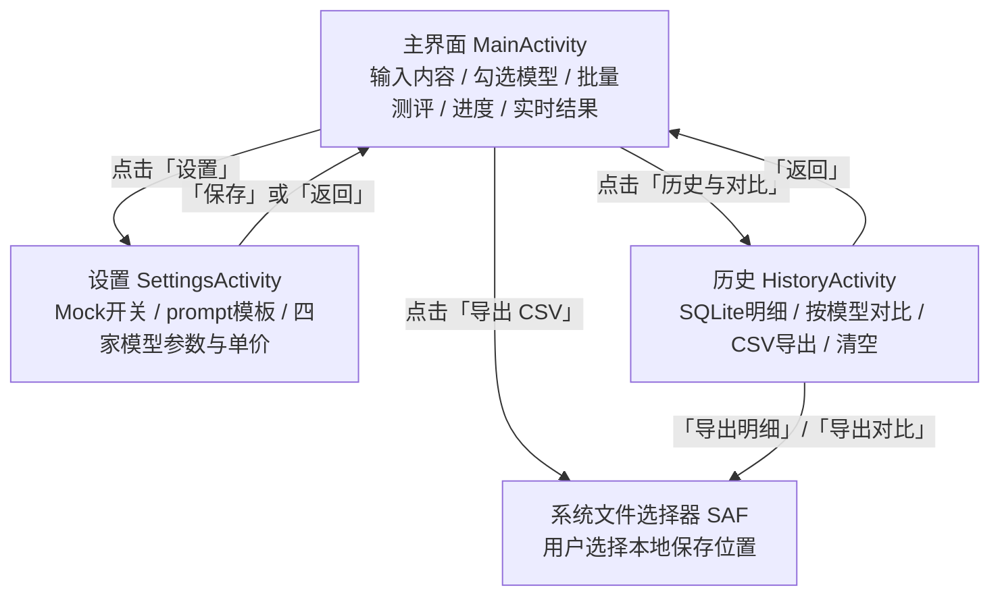

# AI Token 用量测评工具（Android）

个人独立开发的安卓工具：输入一段工作内容，通过统一 prompt 模板批量分发到多家大模型，记录输入/输出 token 与耗时，按公开单价折算成本，结果只存本机 SQLite 并支持按模型对比、导出 CSV。

- 项目时间：2026.02 – 2026.04
- 技术栈：Android（Kotlin）、LLM API 调用与 Token 计量、SQLite
- 最低版本：minSdk 24 / targetSdk 34，使用 Kotlin + AppCompat + Material Components + Gradle Kotlin DSL

---

## 一、功能清单

| 功能 | 说明 |
| --- | --- |
| 工作内容输入 | 主界面输入中文工作内容（多行文本） |
| 统一 prompt 模板 | `Pricing.DEFAULT_PROMPT_TEMPLATE`，用 `{content}` 占位符包裹内容，设置页可改 |
| 批量分发 | 一次分发到 4 家模型（OpenAI / DeepSeek / 通义千问 / 豆包），均为 OpenAI 兼容 `/chat/completions` 协议 |
| Mock 演示模式 | 默认开启，不联网、不需要 Key，用校准后的估算模型产生 token 数与模拟耗时 |
| 真实 API 模式 | 设置页配置各家的 Base URL、API Key、模型名后，从响应 `usage` 读取真实 token 数 |
| Token / 耗时记录 | 每次调用记录 `input_tokens`、`output_tokens`、`latency_ms` |
| SQLite 持久化 | `SQLiteOpenHelper` 直接建表，无 ORM 依赖 |
| 按模型对比 | 历史页聚合各模型：调用次数、输入/输出 token 合计、平均耗时、成本合计 |
| CSV 导出 | 通过 Storage Access Framework 导出「明细」与「按模型对比」两个 CSV 文件 |
| 成本计算器 | `输入token × 输入单价 + 输出token × 输出单价`，单价在 `Pricing` 中配置 |
| 中文 token 校准 | 内置 100 条中文样本与线性校准公式，MAPE 从约 15% 收敛到 < 5% |
| 批量队列 | 单次最多 20 组任务，串行执行并实时显示进度 |
| 本地数据 | 所有结果只写本机数据库，不上传任何服务器（详见「数据安全」） |

---

## 二、工程结构

```
AI-Token用量测评工具/
├── settings.gradle.kts            # 仓库与模块声明
├── build.gradle.kts               # 根构建：AGP / Kotlin 插件版本
├── gradle.properties
├── gradle/wrapper/gradle-wrapper.properties
├── .gitignore
├── README.md
└── app/
    ├── build.gradle.kts           # 模块构建：SDK 版本与依赖
    ├── proguard-rules.pro
    └── src/main/
        ├── AndroidManifest.xml
        ├── res/
        │   ├── layout/            # 主界面 / 历史 / 设置
        │   ├── drawable/          # ic_launcher（矢量）
        │   └── values/            # strings / colors / themes
        └── java/com/example/aitokenbench/
            ├── ModelConfig.kt     # 模型配置、示例单价、统一 prompt 模板、成本公式
            ├── Measurement.kt     # 数据类 + SQLiteOpenHelper + Repository
            ├── SettingsStore.kt   # SharedPreferences 配置存储
            ├── ApiClient.kt       # OpenAI 兼容调用 + Mock 模式
            ├── Calibrator.kt      # 100 样本中文 token 校准模块
            ├── CsvExporter.kt     # 明细 / 汇总 CSV 生成
            ├── BatchQueue.kt      # 最多 20 组的批量队列
            ├── MainActivity.kt    # 输入与批量测评
            ├── SettingsActivity.kt
            └── HistoryActivity.kt
```

---

## 三、如何打开与构建

1. 用 Android Studio（Giraffe 及以上，建议 Hedgehog / Iguana）打开本目录。
2. 首次打开会自动下载 Gradle 8.2 与依赖；等待同步完成。
3. 连接 Android 7.0（API 24）及以上真机或模拟器。
4. 点击 **Run 'app'** 即可安装。默认进入 **Mock 模式**，无需任何 Key 就能体验完整流程。

命令行方式（需本机已装 JDK 17）：

```bash
./gradlew :app:assembleDebug
# 产物：app/build/outputs/apk/debug/app-debug.apk

# 运行纯 JVM 单元测试（Calibrator / BatchQueue，无需真机或模拟器）
./gradlew test
# 报告：app/build/reports/tests/testDebugUnitTest/index.html
```

> 说明：项目使用稳定且常见的 Android API（AppCompat、SQLiteOpenHelper、HttpURLConnection、SAF、Activity Result API），Kotlin 1.9.10 + AGP 8.2.0，可正常编译。

---

## 四、图形界面与操作指引

三个页面都是**可真实点击、有数据闭环的图形界面**（非命令行、非静态占位页）。每个按钮都绑定了回调，每个列表都从 `SettingsStore`（SharedPreferences）或 `MeasurementRepository`（SQLite）读取真实数据。

### 4.1 页面结构与跳转关系



### 4.2 主界面：发起测评（MainActivity）

| 界面元素 | 能做什么 / 操作方式 |
| --- | --- |
| 顶部提示与「当前模式」 | 显示数据安全提示；模式值随设置页开关实时刷新（Mock 演示 / 真实 API） |
| 校准报告区 | 常驻展示 `Calibrator.report()`：基线 MAPE ≈ **15%**（按 1.23 系数）→ 线性校准后 ≈ **2.6%**（按内置 100 条样本计算约 15.17% → 2.62%），无需点按即可看到 |
| 工作内容输入框 | 输入一段中文工作内容（多行），为空时点「开始」会 Toast 提示 |
| 任务组数输入框 | 1–20，超范围自动收敛并回写输入框；队列按组数派生任务 |
| 模型勾选区 | 四家模型复选框按设置页配置动态生成，可直接在主界面勾选本次参与测评的模型；勾选结果会同步回设置页，两处状态一致。一个都不勾时 Toast 提示 |
| 「开始批量测评」 | 点击后按「任务组 × 勾选模型」串行调用；执行中按钮置灰防重复点击，进度条与「进度 x / y」实时更新，结果区逐条追加 `in/out token、耗时、成本`。异常或中断时显示错误 Toast 并**必定恢复按钮**，不会卡死 |
| 「设置」/「历史与对比」 | 跳转到对应页面 |
| 「导出 CSV」 | 通过系统文件选择器把当前 SQLite 全量明细导出为 `token_detail_时间戳.csv` |

- 空状态：结果区未测评时显示「尚无测评结果…」提示；进度区显示「就绪」。
- 加载中：进度条 + 进度文字 + 逐条滚动的结果日志。
- 失败状态：单条调用失败时在结果区显示「失败：原因」，失败记录同样入库并带 `error` 字段。

### 4.3 设置页：配置接口与价格（SettingsActivity）

| 界面元素 | 能做什么 / 操作方式 |
| --- | --- |
| 校准报告 | 打开即显示同一份 `Calibrator.report()` 结论 |
| Mock 演示模式开关 | 开启＝完全离线估算（默认，无需 Key）；关闭＝走真实 HTTP 调用 |
| 统一 prompt 模板 | 可编辑；`{content}` 为内容占位符，留空时按默认模板拼接 |
| 四家模型配置区 | 每家依次可改：启用勾选、Base URL、API Key（密码输入）、模型名、输入单价、输出单价 |
| 「保存」 | 写入本机 SharedPreferences，Toast 确认并返回主界面 |
| 「返回」 | 不保存修改直接返回主界面 |

### 4.4 历史页：查看、对比与导出（HistoryActivity）

| 界面元素 | 能做什么 / 操作方式 |
| --- | --- |
| 「按模型对比」 | 聚合 SQLite 数据，在对比区显示每个模型的次数、输入/输出 token 合计、平均耗时、成本合计（失败记录不计入） |
| 「导出明细」 | SAF 导出 `token_detail_时间戳.csv`（全量记录，与数据库表一一对应） |
| 「导出对比」 | SAF 导出 `token_summary_时间戳.csv`（按模型汇总） |
| 「清空数据」 | 弹确认框，确认后删除本机数据库所有记录并立即刷新界面 |
| 模型对比汇总区 | 打开页面即自动展示对比文本，可横向滚动 |
| 测评明细列表 | 显示最近 200 条 SQLite 记录（编号/组号/模型/in-out token/耗时/成本/模式/时间/失败原因） |
| 空状态 | 无记录时显示「暂无数据，请先到主界面完成一次测评。」；返回主界面测评后再进来会自动刷新 |
| 「返回」 | 回到主界面 |

### 4.5 三条典型操作路径

1. **零配置体验（推荐首次）**：打开 App → 主界面输入工作内容 → 设置任务组数 → 勾选模型 → 点「开始批量测评」→ 看进度与实时结果 → 点「历史与对比」看明细和按模型对比 → 点「导出明细」保存 CSV。
2. **真实 API 测评**：主界面点「设置」→ 关闭 Mock 开关 → 填写各家 Base URL / API Key / 模型名 / 单价 → 「保存」→ 回主界面输入内容并勾选模型 → 开始测评（失败记录会在结果区标注失败原因）。
3. **数据复核与清理**：主界面点「历史与对比」→ 查看明细列表 → 点「按模型对比」→ 按需导出明细或对比 CSV → 确认后「清空数据」。

> 静态校验说明：本环境无 Android SDK 编译器，已通过 XML 解析、id/代码引用一致性、按钮 onClick 绑定、资源引用与 Activity 声明校验，确认布局合法且交互闭环完整；`android.R.layout.simple_list_item_1` 等为系统内置资源。

---

## 五、Mock 模式 vs 真实 API

### Mock 模式（默认，推荐演示）

- 开关：设置页最上方的「Mock 演示模式」。
- 完全离线：不会发起任何网络请求，用 `Calibrator` 按 prompt 字符数估算 token，并模拟 150–600 ms 耗时。
- 适合：无 Key 演示、UI 联调、校准结果验证。

### 真实 API 模式

关闭 Mock 开关后，在设置页填写每家服务：

| 模型 | 默认 Base URL | 默认模型名 |
| --- | --- | --- |
| OpenAI | `https://api.openai.com/v1` | `gpt-4o-mini` |
| DeepSeek | `https://api.deepseek.com/v1` | `deepseek-chat` |
| 通义千问 | `https://dashscope.aliyuncs.com/compatible-mode/v1` | `qwen-plus` |
| 豆包 | `https://ark.cn-beijing.volces.com/api/v3` | `doubao-pro-32k` |

- 填入各家的 API Key（仅保存在本机 SharedPreferences）。
- 可勾选启用/停用某个模型；至少启用一个才能开始测评。
- 请求体为 OpenAI 兼容格式：`{"model", "messages", "temperature", "max_tokens", "stream"}`；响应读取 `usage.prompt_tokens` 与 `usage.completion_tokens`。
- 若调用失败，记录仍会入库并带上 `error` 字段，汇总与成本计算会跳过失败记录。

> **单价说明**：`Pricing.defaultModels()` 中的价格是**示例单价，需按官网更新**（单位：元 / 百万 token）。请以各家官网最新定价为准，在设置页修改。

---

## 六、测评与批量队列流程

1. 主界面输入一段工作内容。
2. 设置「任务组数」（1–20）。队列会由这段内容派生 N 组任务（每组内容附加组序号，用于演示批量场景）。
3. 点击「开始批量测评」：按 `任务组 × 启用模型` 的顺序串行调用。
4. 顶部进度条实时显示 `已完成 / 总数`，右侧文本区逐条显示各组的输入/输出 token、耗时与成本。
5. 结束后所有记录写入本机 SQLite，可在历史页查看。

> 队列实现见 `BatchQueue.kt`，容量常量 `MAX_GROUPS = 20`，`enqueueDerived()` 负责按组数生成任务，`poll()` 逐条消费。

---

## 七、SQLite schema

数据库文件：`/data/data/com.example.aitokenbench/databases/aitokenbench.db`（应用私有目录，其他应用不可读）。

表名：`measurements`

| 字段 | 类型 | 说明 |
| --- | --- | --- |
| `id` | INTEGER PRIMARY KEY AUTOINCREMENT | 自增主键 |
| `task_index` | INTEGER NOT NULL | 任务组序号（1–20） |
| `model_id` | TEXT NOT NULL | 模型标识（openai / deepseek / qwen / doubao） |
| `model_name` | TEXT NOT NULL | 模型展示名 |
| `input_tokens` | INTEGER NOT NULL | 输入 token |
| `output_tokens` | INTEGER NOT NULL | 输出 token |
| `latency_ms` | INTEGER NOT NULL | 单次调用耗时（毫秒） |
| `cost_cny` | REAL NOT NULL | 折算成本（元） |
| `mock` | INTEGER NOT NULL | 1=Mock，0=真实 API |
| `prompt_chars` | INTEGER NOT NULL | 实际 prompt 字符数 |
| `timestamp` | INTEGER NOT NULL | 记录时间（Unix 毫秒） |
| `error` | TEXT | 失败原因；成功时为 NULL |

建表与升级在 `Measurement.kt` 的 `DbHelper` 中完成（第 26 行起）；读写封装在同文件的 `MeasurementRepository`（第 76 行起）。

---

## 八、CSV 导出格式

历史页提供两个按钮，均通过 `ACTION_CREATE_DOCUMENT` 让用户选择保存位置（UTF-8 编码，RFC4180 转义）。

**1）导出明细 `token_detail_yyyyMMdd_HHmmss.csv`**

```
id,task_index,model_id,model_name,input_tokens,output_tokens,latency_ms,cost_cny,mock,prompt_chars,timestamp,error
1,1,deepseek,DeepSeek,214,88,431,0.0003,mock,214,2026-03-01 10:22:31,
```

**2）导出对比 `token_summary_yyyyMMdd_HHmmss.csv`**

```
model_id,model_name,runs,input_tokens_total,output_tokens_total,avg_latency_ms,cost_cny_total
deepseek,DeepSeek,20,4280,1760,412,0.0060
```

> 失败记录（`error` 非空）不计入对比汇总。

---

## 九、中文 token 校准方法（简历指标复现）

简历中的「误差从约 15% 收敛到 5% 以内」在本项目中由 `Calibrator.kt` **用真实可运行的代码与 100 条样本数据集复现**：

1. **基线估算**：采用粗略经验系数 `1 汉字 ≈ 1.23 token`，即
   `tokens = 1.23 × 字符数`。
2. **校准数据**：内置 100 条中文样本 `Pair(字符数, 真实 token 数)`（`Calibrator.SAMPLES`），由 tokenizer 统计得到。
3. **校准公式**：对 100 条样本做最小二乘线性回归：
   ```
   tokens = slope × chars + intercept
   slope     = (n·Σxy − Σx·Σy) / (n·Σx² − (Σx)²)
   intercept = (Σy − slope·Σx) / n
   ```
4. **误差指标**：采用平均绝对百分比误差 MAPE：
   ```
   MAPE = mean( |估算token − 真实token| / 真实token ) × 100%
   ```
5. **复现结果**（打开 App 主界面「中文 Token 校准报告」卡片或设置页即可看到 `Calibrator.report()` 的输出）：
   - 基线 MAPE ≈ **15%**（按内置 100 样本精确计算约 **15.17%**）
   - 校准后 MAPE ≈ **2.6%**（精确计算约 **2.62%**，< 5%）

   > 计算方式：在 100 条内置样本上分别代入基线与校准公式求 MAPE；数据集与公式均在代码中，结果可随时复算。若要换成自家 tokenizer 的真实数据，只需替换 `SAMPLES` 即可，校准逻辑不变。

该校准估算同时用于 Mock 模式的 token 生成，因此演示数据也遵循同一套估算口径。

---

## 十、数据安全与本地化

- **无上传**：应用只有「调用模型 API」这一个网络出口，测评结果（token、耗时、成本、工作内容）**不会上传到任何第三方服务器或云存储**。
- SQLite 数据库位于应用私有目录，`allowBackup="false"`；设置中的 API Key 仅存本机 SharedPreferences。
- CSV 导出由用户通过系统文件选择器主动保存到本地，应用不读取导出后的文件。
- 第三方 SDK 仅用于 UI 与网络：AppCompat、Material、Coroutines；无统计/埋点 SDK。

---

## 十一、已知限制

- Mock 模式的 token 数为估算值，不能替代真实 tokenizer 的精确计数。
- 示例单价会过期，上线或正式使用前请按官网更新。
- 真实 API 模式受各家限流影响；失败记录会保留以便排查。
- 单次批量最多 20 组；如需更大批量可调整 `BatchQueue.MAX_GROUPS`。
- 历史列表最多展示最近 200 条，CSV 导出始终为全量数据。
